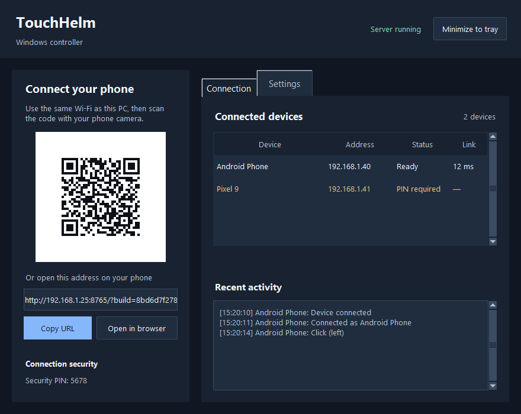
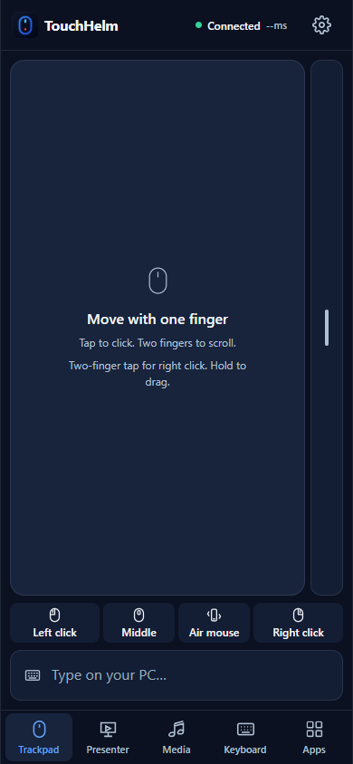
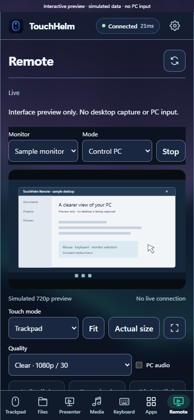
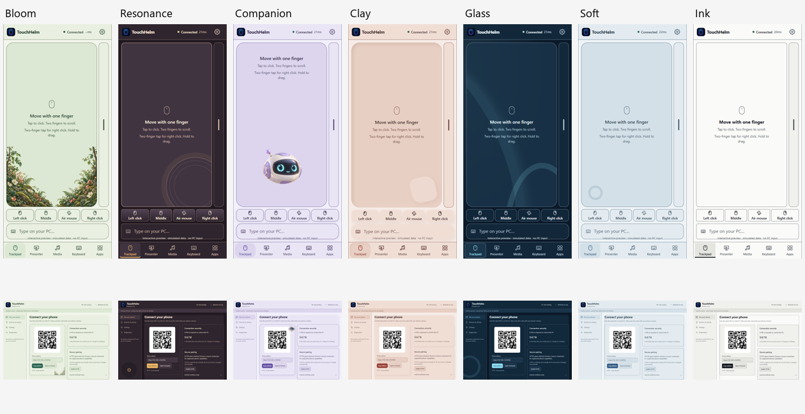
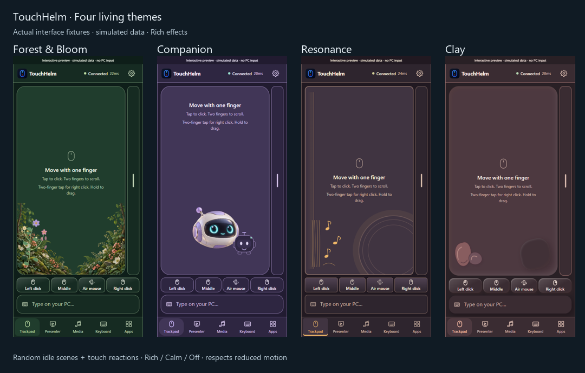

# TouchHelm

**Your PC, at your fingertips.** TouchHelm 2 adds a shared visual system, dependable composition, and controls driven by actual Windows capabilities.

Turn your phone into a Windows trackpad, keyboard, presentation remote, media controller, app launcher, and live desktop viewer/controller. TouchHelm runs on your PC and serves its controls to a phone browser over your local network or private Tailscale connection. Scan the desktop QR code to connect; no phone APK is needed.

<p>
  
  
</p>

*Previews use synthetic QA device data and illustrate the interface rather than an active connection.*

## Windows test installer

[Download Test 3 setup](https://github.com/myselfpankajk4/TouchHelm/releases/tag/v2.2.0-test.3)
and run `TouchHelm-2.2.0-test3-setup-win-x64.exe` on Windows 10/11 x64.
The setup download is **160.4 MiB** (about 618 MiB installed), approximately 70%
smaller than Test 1's offline portable download.
This is the normal installation: a Windows Installed apps entry, Start Menu
shortcut, desktop shortcut selected by default, and an uninstaller. Python,
screen/audio libraries, the isolated camera runtime and models are included.
**No Python installation, PATH change, pip command, or feature download is needed.**
Setup reuses Windows' WebView2 and prepares it automatically if missing; only
that Microsoft runtime may need internet. See [installer details](docs/WINDOWS_INSTALLER.md)
and [verification](docs/WINDOWS_INSTALLER_VERIFICATION.md).

This test installer is unsigned, so SmartScreen can still warn or block it.
Changing the compiler or adding shortcuts does not establish publisher trust.
Private GitHub releases require repository access; the setup EXE can also be
shared directly with testers.

### Earlier portable builds

[Download compact Test 2](https://github.com/myselfpankajk4/TouchHelm/releases/tag/v2.2.0-test.2)
and open `TouchHelm-2.2.0-test2-compact-win-x64.exe` on Windows 10/11 x64.
The download is **29.5 MiB**, reduced from 533.2 MiB. Python and the core app are
included; first launch automatically prepares screen/audio and isolated camera
components, and installs WebView2 only if missing. **Internet is needed for that
first preparation.** No developer tools or manual requirements installation are
needed. Prepared components and settings are reused on later launches.

The desktop now groups QR, phone address and PIN together, with compact navigation,
native task rows, grouped settings and disclosed advanced setup. See
[compact setup and testing](docs/COMPACT_TESTING.md) and
[verification](docs/COMPACT_VERIFICATION.md). The larger
[offline Test 1](https://github.com/myselfpankajk4/TouchHelm/releases/tag/v2.2.0-test.1)
remains available.

This EXE is unsigned: Windows publisher, SmartScreen, firewall and camera prompts
may still appear. See [compact testing and limitations](docs/COMPACT_TESTING.md).
Private GitHub releases require repository access; the EXE can also be shared
directly with testers. The source-development requirements below apply when
running from the checkout.

## Features

**AirControl:** choose **Control via phone** or **AirControl** at desktop startup.
Head & Face is the fresh-profile default: point with your head, then dwell to
click, right-click, double-click or drag/drop using the floating action dock.
Hand pointing/pinches and combined control remain available. Calibration, a
non-injecting practice cursor, remappable profiles,
animated guides, a native status HUD and Windows dictation are included. The
camera starts only on **Start camera**; setup uses a separate checksum-locked
runtime. Phone viewing/audio stay connected when AirControl takes input ownership.
[Setup and gesture guide](docs/AIRCONTROL.md) ·
[Verification and physical-test limits](docs/AIRCONTROL_VERIFICATION.md).

**Focused PC text and pairing guides:** Trackpad now reads and edits supported
focused Windows fields in both directions. Sync recovers automatically; overlapping
edits follow the PC. Selecting a supported PC field opens the phone typing dock,
and Clear clears that linked field. Password and read-only fields are excluded.
A host PIN is required. See
the [mobile certificate and Tailscale guide](docs/PAIRING.md) for setup and limits.
Selecting an HTTPS mode on the PC reveals its instructions beside the QR.

**Remote (v2.2):** Control PC or View PC with live monitor video, trackpad/direct touch, pinch zoom, keyboard/numpad, quality presets and optional PC audio. Streaming starts disabled and requires a host PIN plus trusted HTTPS. The Cast phone to PC option guides compatible system casting; mobile browsers cannot capture the phone screen. [Setup, limitations and verification](docs/REMOTE.md).

Remote now defaults to Clear 1080p, with a 1440p Detail option. Tab switches keep
the stream; Stop leaves the rest of TouchHelm connected. Pairing survives refreshes
in the same browser tab. New setups receive a generated password, and desktop
Settings provides a Windows Wireless Display installer with installation progress
and Windows administrator approval. Media can stream **PC audio only**, sharing
its toggle with Remote while leaving screen capture off. Fullscreen requests
landscape on supported browsers; measured cursor positions appear over the viewer.
Generated PINs are four numeric digits. Desktop **Set up trusted pairing** prepares
private HTTPS through Tailscale without a phone certificate download; sign-in on
the PC and phone is still required. All seven existing themes use procedural
CSS/JavaScript/SVG effects rather than the former botanical/robot background images.



| Tab | What it does |
| --- | --- |
| **Trackpad** | Large movement surface, left/middle/right clicks, tap, hold-to-drag, two-finger scrolling, edge scrolling, and optional air mouse. |
| **Remote** | Live PC viewing/control, monitor selection, zoom, native keys, optional system audio, and a Miracast setup guide. |
| **Typing dock** | Live typing by default, with optional buffering and two-way sync for supported focused PC fields. Return inserts a newline; PC Enter submits explicitly. Touching the pad dismisses typing and preserves the draft without PC input. |
| **Presenter** | Previous/next above a large laser surface, monitor selection, independent countdown, and an optional PowerPoint slide/preview/notes drawer. |
| **Media** | Now Playing with artwork, metadata, stateful Play/Pause, timeline, seeking and supported repeat/shuffle/speed controls. A queue appears only when a provider supplies one. |
| **Keyboard** | Native press/release, F1–F24, letters, symbols, navigation, left/right modifiers, editing shortcuts, and integrated Numpad. Hold or latch modifiers for chords such as **Ctrl+Shift+A**. |
| **Apps** | Real Windows icons and verified windows. Pinned apps first, then running/frequently opened apps. Hold or choose Actions for Open, Focus, Pin, Details and normal Close window. Save prompts stay on the PC. |

Seven complete themes—**Forest & Bloom, Resonance, Companion, Clay, Glass, Soft UI and Ink**—cover phone and desktop. Each supports light/dark appearance, reduced motion and increased contrast. Preferences belong to each device. Optional PIN pairing and trusted HTTPS, desktop device status, and system-tray support are included.

**Living controls (v2.1):** Bloom grows vines and flowers around controls, Companion blinks and follows touches, Resonance plucks decorative strings, and Clay reacts with tactile impressions. Choose **Rich / Calm / Off** in Themes; system reduced motion takes priority. Decorations pause around active pointer control and never intercept input.

Live typing starts enabled on new devices and remembers explicit opt-out. Return still adds a newline. Drafts edited offline pause live synchronization until **Send**, so reconnecting cannot replay them. Media uses a shared playback clock for elapsed time, seek thumb and progress; unavailable artwork has an explicit placeholder.

Optional **private Tailscale HTTPS** pairs Windows and Android without installing TouchHelm's CA. Both devices must have Tailscale installed and connected to the same tailnet. Setup lives in the desktop Pairing panel; HTTP and local-certificate HTTPS remain available. See the [living controls and verification record](docs/LIVING_CONTROLS.md).





Open **`/preview.html`** on the running host for an interactive preview board with all tabs, desktop panels, themes and simulated states. Preview transport cannot send PC input. [Implementation and acceptance record](docs/TOUCHHELM_V2.md) · [Desktop and HTTPS guide](docs/desktop-v2.md).

## Source-development requirements

These apply when running from the checkout. The Windows installer includes its
own Python and application libraries; testers do not need the setup below.

- **Host:** Windows 10/11, Python, Windows PowerShell, WebView2 Runtime and .NET Framework 4.6.2 or later. Python 3.13 is used in this workspace. Tkinter remains available for the classic rollback UI.
- **Phone:** a modern browser on the same reachable local network as the PC. The UI supports phone, landscape, and desktop browser sizes.
- **Network:** HTTP/WebSocket **8765**, optional local HTTPS/WSS **8766**, discovery UDP **53317**. Private Tailscale Serve uses **HTTPS 8443** and a loopback-only backend on **8767**. Allow the LAN host through Windows Firewall on your private network if prompted.

Node.js is needed only for development tests, not normal app use.

## Run from source

This repository is private. Clone it with a GitHub account that has access:

```powershell
git clone https://github.com/myselfpankajk4/TouchHelm.git
cd TouchHelm
.\run.bat
```

On first launch, `run.bat` creates `.venv` and installs the pinned Python dependencies. Later launches use that environment and run the current source.

1. Keep the phone and PC on the same network.
2. Scan the QR code in the TouchHelm desktop window.
3. Open the link and enter a PIN if enabled.
4. Select a tab and control your PC.

The selectable PC address and **Copy URL** button provide an alternative to scanning. Keep the host running; **Minimize to tray** hides its window without disconnecting the phone.

### Manual setup

```powershell
python -m venv .venv
.\.venv\Scripts\python.exe -m pip install -r requirements.txt
.\.venv\Scripts\python.exe main.py
```

Enable PIN pairing, run without the desktop window, or choose the classic desktop:

```powershell
.\.venv\Scripts\python.exe main.py --pin 1234
.\.venv\Scripts\python.exe main.py --headless
.\.venv\Scripts\python.exe main.py --classic-ui
```

Use your own four-digit PIN; `1234` is an example. Changing/enabling a PIN revokes phone authorization and releases held inputs.

### Updates

Pull changes, then launch `run.bat` again. The single-instance launcher restores the current window when source and startup settings match. Changed source requests graceful shutdown and starts the new build after ownership is released. It reports failure if that handoff cannot finish safely. The QR carries the current browser build; the phone checks on open/focus and refreshes a confirmed changed build while keeping its draft.

Browser preferences and saved update drafts migrate from the former app name. This workspace's **TouchHelm (Latest)** shortcut points to the source launcher and uses the TouchHelm icon. For a host started before v2, quit that older host once before using the new single-instance lifecycle.

## App compatibility

Details depend on what each desktop application exposes:

| Integration | Available behavior |
| --- | --- |
| **PowerPoint** | Deck title, slide count/title, slideshow state, direct COM commands, on-demand current/next previews, notes and slide selection. |
| **Other recognized presenter/browser/PDF windows** | Verified presentation-window context and guarded keyboard fallback. Generic browser windows are rejected; unavailable slide counts/previews remain unavailable. |
| **Windows media sessions** | Player selection, artwork, metadata, state/timeline, seek bounds, and supported playback/seek/shuffle/repeat/rate commands. |
| **Windows Media Player** | Selectable queue when a running instance exposes it through COM. |
| **Volume/brightness** | Native volume keys request the Windows flyout. TouchHelm overlays use measured readback. Missing readback stays unavailable; brightness depends on monitor/driver support. |

Windows media sessions provide no universal playlist API. TouchHelm does not scan Music/Videos folders in this flow. App windows use registered or executable identity; uncertain matches are not labeled Running. Windows may refuse foreground activation. Launch counts record successful requests, not proof that an app finished opening. Elevated applications can reject ordinary native input; hardware Fn functions are not promised.

## Settings and privacy

Local settings are saved automatically in `config.json`, which is excluded from Git. `config.example.json` is a clean reference without a personal hostname or enabled PIN. Launch history in `.touchhelm_usage.json` is also excluded.

| Setting | Default | Range/values |
| --- | --- | --- |
| Port | `8765` | 1–65535; restart to change listening port |
| Pointer sensitivity | `1.3` | 0.4–3.5 |
| Pointer acceleration | `1.25` | 1.0–2.5 |
| Scroll speed | `1.0` | 0.3–2.5 |
| Natural scrolling | Off | On/off |
| PIN required | Off | Four ASCII digits when enabled |
| Laser color | Red | Red, green, blue, amber |
| Theme | Glass | Bloom, Resonance, Companion, Clay, Glass, Soft UI, Ink; device-local |
| HTTPS | Off, port `8766` | Enable on desktop; manually trust this PC’s public CA on Android |
| Private Tailscale HTTPS | Off | Desktop setup; same tailnet, host PIN, HTTPS 8443 |
| Live typing | On for a new device | Device-local opt-out; offline drafts require explicit Send |
| Living effects | Rich | Rich / Calm / Off; system reduced motion wins |

The default transport is HTTP/WebSocket for a trusted local network. Optional HTTPS uses a local CA and address-specific server certificate; private keys remain in a restricted user folder outside served assets. Trust installation is manual. An authenticated, short-lived, single-use handoff transfers drafts/preferences between HTTP and HTTPS; authentication is rechecked. See the [Android setup instructions](docs/desktop-v2.md#optional-android-https-setup).

An enabled PIN gates input, context/catalog queries, settings and private artwork/icons. Asset URLs contain opaque IDs; authentication uses headers. App/media commands use registered catalog IDs. The privileged desktop bridge belongs only to the owned local desktop window and has no phone HTTP command route.

## Development and verification

The host uses Python/aiohttp, an owned WebView2 desktop shell (with Tk rollback), and Win32 input. The phone uses plain HTML/CSS/JavaScript. A lazy hidden PowerShell bridge provides COM/WinRT context; slow provider work runs outside the input event loop and returns bounded failure states.

### Safe Python regressions

After installing `requirements.txt`, run on Windows:

```powershell
.\.venv\Scripts\python.exe -m unittest discover -s tests -p "test_*.py"
```

### Browser checks

With Node.js 20 or later:

```powershell
npm ci
npm test
npx playwright install chromium
npm run test:browser
```

`npm run test:visual` additionally writes screenshots to `tests/artifacts/`. `PLAYWRIGHT_MODULE` and `CHROMIUM_EXECUTABLE` can select an existing installation. No Codex runtime is required.

These suites mock native effects so they do not type, click, launch apps, play media, change volume/brightness, or lock the PC. **`test_touchhelm.py` is an older manual native-action script, not a safe regression suite.** Do not run it for unattended verification.

Physical phone gestures, live PowerPoint/player integration, and native feedback still need a device smoke test. See [BUGFIX_REPORT.md](BUGFIX_REPORT.md) for evidence and limitations.

## Project layout

```text
main.py                    Desktop/headless entry point
run.bat                    Source launcher and first-run setup
gui/webview_window.py      Owned WebView2 bridge, pairing, devices, tray
gui/web/                   Shared themed desktop interface
gui/app_window.py          Classic Tk rollback interface
server/web_server.py       HTTP/WebSocket and authentication
server/windows_input.py    Native input, volume and brightness
server/aircontrol/         Isolated webcam worker, gestures, ownership, HUD and speech
server/desktop_services.py Async catalog/context interface
server/desktop_bridge.ps1  COM/WinRT providers
server/osd_overlay.py      Desktop feedback
server/build_version.py    Content-derived browser versions
server/instance_control.py Latest-source restore/restart lifecycle
server/secure_pairing.py   Local CA, LAN certificates and user ACLs
server/asset_store.py      Bounded opaque artwork/icon cache
web/                       Phone controls, themes, PWA assets
android/                   Experimental Android WebView wrapper
tests/                     Safe regressions and previews
docs/images/               README interface previews
```

The browser is the supported phone entry point. The Android scaffold has been renamed to `com.touchhelm.app`; no APK build or Android device test is claimed. See [android/README.md](android/README.md).

## Troubleshooting

- **Cannot connect:** check the displayed address, reachable network, running host, and private-network firewall permission. Guest Wi-Fi/client isolation may block access.
- **Old UI:** launch TouchHelm (Latest) and scan the current QR. Changed source uses the graceful single-instance restart. Quit a pre-v2 host once if it is still running.
- **No media/presentation details:** open the application on the PC; unavailable fields depend on provider support.
- **Vibration missing:** use Settings → Test vibration. An accepted API request is not proof of a physical pulse; browser support, user activation and phone settings matter.
- **Air mouse or keep-awake unavailable:** complete trusted HTTPS pairing and grant browser permission. Other remote controls remain usable; keep-awake can still be released by the OS.

This is a private development repository. No public release or open-source license is currently declared.
