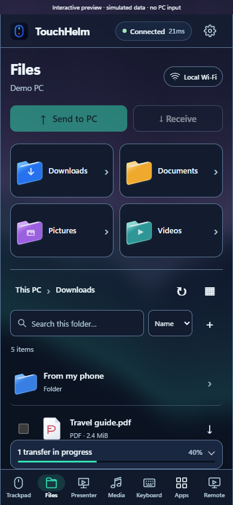
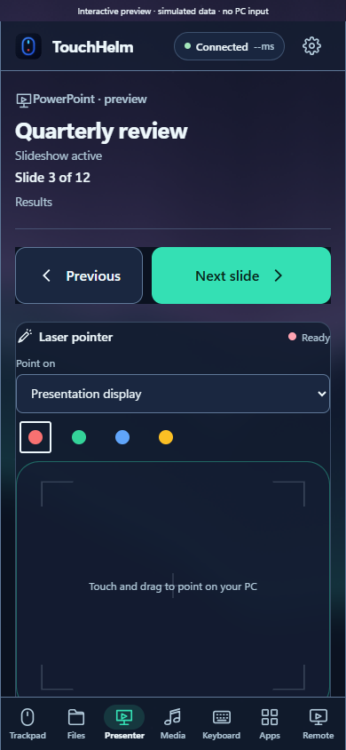
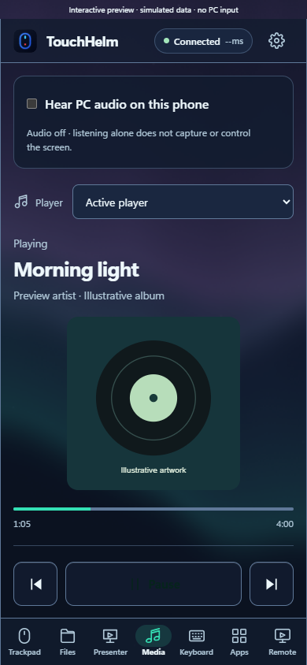
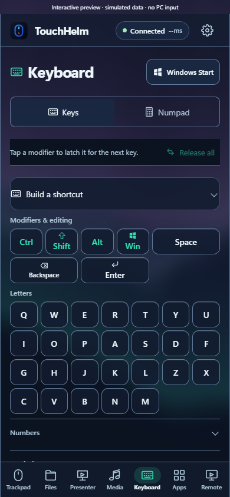
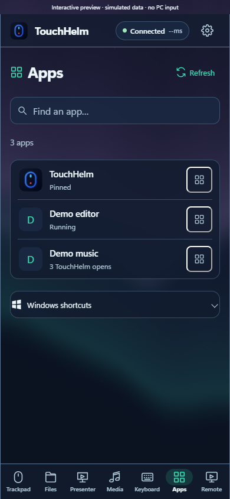
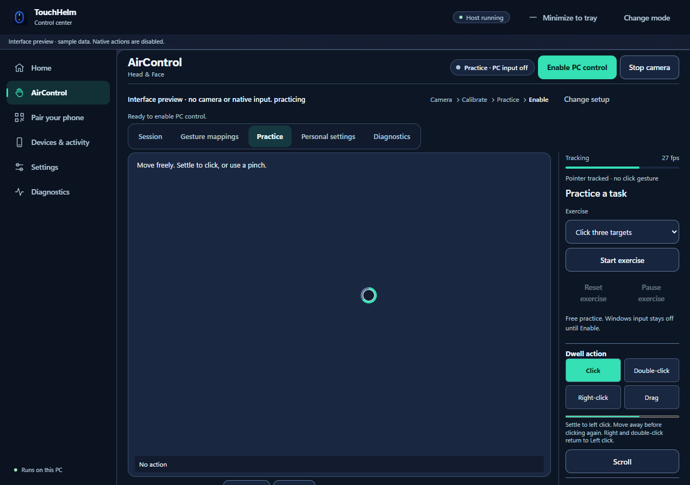

# TouchHelm

**Your PC, at your fingertips.** Use your phone as a Windows trackpad, keyboard, file browser, presentation remote, media controller and live desktop viewer. Or control the PC with its webcam through AirControl.

TouchHelm runs on your Windows PC and opens in your phone's browser over local Wi-Fi. No phone app, VPN, manually trusted certificate or internet relay is needed.

**[Download TouchHelm 2.2.3 for Windows](https://github.com/myselfpankajk4/TouchHelm/releases/download/v2.2.3/TouchHelm-2.2.3-setup-win-x64.exe)** · [All releases](https://github.com/myselfpankajk4/TouchHelm/releases) · [Setup and local Wi-Fi guide][local-guide]

## Current interface


<p>
  
  
  
</p>

Screenshots captured from the **2.2.3 interface on 1 November 2026** using preview mode and synthetic fixtures. Devices, files, artwork, tracking measurements and remote video are examples; no personal files, live pairing credentials, camera image or PC capture are shown.

<details>
<summary>More phone screens: Presenter, Media, Keyboard and Apps</summary>

<p>
  
  
</p>
<p>
  
  
</p>

</details>

## Install and connect

1. Download the installer above and run it on **Windows 10/11 x64**. It adds TouchHelm to Installed apps, a Start Menu shortcut, an optional desktop shortcut and an uninstaller.
2. Put your phone and PC on the same reachable Wi-Fi. **Android Chrome** is the primary phone target; no phone installation is required.
3. Open TouchHelm on the PC, choose **Pair your phone**, and scan the local QR code. You can also copy the displayed address into Chrome.
4. Enter the PC PIN when prompted. Enable **File access** or **Screen and audio access** on the PC when you want those features; both require PIN protection.
5. Choose a phone tab. Keep TouchHelm running on the PC; **Minimize to tray** keeps the connection available.

The installer bundles its own Python, application libraries, screen/audio providers and isolated AirControl camera runtime/models. No system Python, pip command or PATH change is required. Setup reuses Microsoft's WebView2 and downloads its bootstrapper automatically if that runtime is missing; this setup step may need internet. Pairing and normal controls, file transfers and media use the local network without internet service.

**Updating:** exit TouchHelm from its tray menu, then run the newer installer. Updates use the existing app entry and preserve settings; routine upgrades do not require uninstalling first. [Installer details][installer-guide]

The test installer is unsigned. Windows may display SmartScreen or publisher prompts; TouchHelm does not promise warning-free installation.

## Seven phone tabs

| Tab | Features |
| --- | --- |
| **Trackpad** | Large pointer surface; tap to click, hold to drag, two-finger scrolling/right click, edge scrolling and explicit left/middle/right buttons. A compact typing dock keeps text entry beside the pointer controls. |
| **Files** | Browse local drives and Windows folders; search, sort, switch list/grid views and load more entries. Preview supported images, audio/video and PDFs; send phone files to a chosen PC folder or receive PC files through Chrome. |
| **Presenter** | Previous/next slide, a large coloured laser surface, monitor selection and countdown timer. Supported PowerPoint sessions expose deck/slide context, current/next previews, speaker notes and slide selection. |
| **Media** | Now Playing, artwork, artist/album information, player selection, timeline/seek and supported playback, shuffle, repeat and speed controls. Listen to PC audio without streaming its screen. |
| **Keyboard** | Letters, symbols, navigation, F1–F24, native press/release, latched modifiers, shortcut combinations, Windows Start and an integrated Numpad. Release held keys explicitly when needed. |
| **Apps** | Search registered Windows apps, view available app icons and verified windows, launch/focus apps, pin favourites and request normal window closure so application save prompts remain available. |
| **Remote** | View or control a PC monitor with live video, trackpad/direct touch, pan, pinch zoom, cursor feedback, Fit/Actual size, fullscreen, quality presets, native keys and optional PC audio. |

### Files and local media

- **Browse:** Desktop, Downloads, Documents, Pictures, Music, Videos and available local drives. Breadcrumbs, folder search, sorting and list/grid views help navigate larger folders.
- **Send to PC:** choose files using the phone's picker, select a destination, or create a new folder. Existing files are preserved; duplicate names receive a number.
- **Receive:** save individual or selected files through Chrome downloads. Chrome manages the phone's download permission and save location.
- **Preview:** supported images and media open inside Files. PDFs have one **Open PDF in Chrome** action and a Receive option. Supported audio/video can also open in a separate Chrome tab; the inline player pauses when you do this.
- **Audio formats:** MP3, M4A, WAV, Ogg, FLAC and AAC/ADTS (`.aac`, `.adts`) are recognised. Video formats include MP4, WebM and MOV. Playback still depends on the file's codec and the phone browser; Receive is the fallback for unsupported files.
- **Portrait video:** the full frame uses contain sizing, with native controls fitted above navigation. The player adjusts to viewport changes and expanded/collapsed transfer history.
- **Transfers:** a mini progress strip expands on tap to show names, direction, detailed progress, history, Cancel and Retry. Progress updates do not open it automatically. Uploads/downloads stream in bounded chunks rather than loading an entire file into phone memory.
- **Limits:** up to **16 GiB per file** and 32 files per phone selection/queue. File sessions expire after 30 minutes. These are implementation limits, not a claim that every phone has completed a 16 GiB transfer.

File access follows the signed-in Windows user's permissions. Network shares, reparse redirects and cloud-only placeholders are restricted; TouchHelm does not download cloud-only files in the background. Disconnecting or revoking access ends the file session. [Files setup and limits][local-guide]

### Live typing and two-way PC text

Live typing is on by default for a new phone. Supported focused Windows fields can sync in both directions: focusing an editable PC field can raise the phone typing dock, PC edits appear on the phone, and phone edits update the active field. Selected Chrome autocomplete suggestions do not replace an ongoing phone draft.

Password and read-only fields are excluded. Support depends on the application's Windows accessibility information; this is not universal text-field access. Offline drafts remain local and require explicit Send after reconnecting. [Typing and pairing guide][typing-guide]

### Remote viewing, control and PC audio

Choose **Control PC** or **View PC**, select a monitor, and use trackpad or direct-touch interaction. Pinch to zoom, pan without clicking the PC, or enter fullscreen. Quality presets cap video at Saver 540p/15, Balanced 720p/30, Clear 1080p/30 or Detail 1440p/24; actual performance depends on hardware and the network.

The **Hear PC audio on this phone** option in Media and PC audio in Remote share one controller. Audio-only mode captures the Windows output device without capturing the screen or granting pointer control. Playback starts after host confirmation; Unmute appears if Chrome requires another playback gesture.

Windows lock, permission changes and disconnects release app-owned input. Switching phone tabs can keep the stream alive; backgrounding/locking the phone can pause it and require Resume. The casting guide covers compatible Windows Wireless Display setup; TouchHelm does not guarantee receiver compatibility. [Remote guide][remote-guide]

## AirControl: use the PC webcam



Choose **AirControl** on the desktop for **Head & Face**, **Hand** or **Combined** control. Head & Face is the fresh-profile default. The camera starts only when you select **Start camera**.

- Select a camera and monitor, calibrate, and practice with a simulated cursor before enabling PC control.
- Head mode includes dwell-based left/right/double click, two-step drag/drop and a scrolling action dock. Personal expression calibration supports additional actions.
- Hand mode uses knuckle-centred pointing, anchored clicks, pinch gestures, scrolling, and pause/resume gestures. Profiles and advanced gesture mappings are adjustable.
- Practice includes click targets, drag/drop, scrolling and free movement. Practice sends no Windows mouse or keyboard input.
- Session, Gesture mappings, Practice, Personal settings and Diagnostics separate setup from daily use. Pause/Stop, the floating HUD and tray controls provide escape routes.
- Windows dictation and Voice Access guidance are available. Windows manages microphone/speech permissions.
- Tracking runs in the isolated PC camera runtime. Reports contain bounded diagnostics and are exported only on request; they do not upload camera frames or field contents.

Tracking quality depends on the webcam, lighting, pose and hardware. Physical camera and speech acceptance remain separate from simulated tests. [AirControl setup][air-guide] · [Practice and daily-use details][air-daily-guide]

## Appearance and desktop controls

Five themes—**Aurora** (default), **Bloom**, **Resonance**, **Constellation** and **Ink**—cover phone and desktop, with light/dark appearance and increased contrast. The generative themes offer Rich, Calm and Off effects; reduced-motion preferences take priority. Preferences are saved per device. Browser-dependent vibration feedback has its own test control. [Theme details][theme-guide]

The desktop control centre includes mode selection, pairing, connected devices/activity, settings, diagnostics, remote Stop controls and minimise-to-tray. Camera, Files and screen/audio permissions remain explicit PC-side choices.

## Connection, privacy and compatibility

Controls and files use **local HTTP/WebSocket without TLS**. Screen and PC audio use **direct encrypted WebRTC** between verified local peers. Home Wi-Fi does not turn HTTP into end-to-end encryption; use a trusted private network. No internet relay, STUN/TURN fallback, mobile certificate or router port forwarding is configured.

PIN protection, peer/Host/Origin checks, bounded work and disconnect cleanup guard access. Files and screen/audio start disabled and have separate PC permissions. Phone pages cannot grant themselves these permissions. Config, tokens and native helper data stay outside served assets.

PowerPoint, Windows media sessions, app windows, volume and brightness expose different capabilities. Missing slide counts, playlists, seek/readback or other provider features remain unavailable. TouchHelm cannot unlock Windows, cross UAC, wake a powered-off PC or guarantee input to elevated applications. Hardware Fn functions and universal playlist access are not promised.

## Run the released source

The installer is the normal end-user path. Source development needs Windows, Python 3.13 and the Windows UI/runtime dependencies described in the guides. Node.js 20+ is needed only for browser development/tests.

```powershell
git clone https://github.com/myselfpankajk4/TouchHelm.git
cd TouchHelm
git checkout v2.2.3
.\run.bat
```

This checks out the released source matching the screenshots. `run.bat` creates the source virtual environment and installs its pinned dependencies. Optional source-mode streaming/camera setup is documented in the Remote and AirControl guides; these components are bundled in the Windows installer.

For a manually prepared source environment:

```powershell
python -m venv .venv
.\.venv\Scripts\python.exe -m pip install -r requirements.txt
.\.venv\Scripts\python.exe main.py
```

`main.py --pin <four-digits>`, `--headless` and `--classic-ui` select PIN protection, headless hosting and the Tk fallback. Settings are stored in the checkout's ignored `config.json` for source mode, or `%LOCALAPPDATA%\TouchHelm` for the installed app. The normal ports are HTTP/WebSocket **8765** and discovery UDP **53317**.

### Development checks

```powershell
.\.venv\Scripts\python.exe -m unittest discover -s tests -p "test_*.py"
npm ci
npm test
npx playwright install chromium
npm run test:browser
```

`npm run test:visual` captures UI screenshots. The regression harnesses mock native PC effects; physical phone, camera, PowerPoint/player and Windows integration still need participating-user checks. `test_touchhelm.py` is a legacy manual native-action script, not an unattended regression suite.

## Troubleshooting

- **Cannot connect:** keep the host running, use its current address, allow private-network firewall access and avoid guest-network client isolation.
- **Files or screen/audio unavailable:** enable that specific permission on the PC and pair with its PIN. Phone settings cannot enable it.
- **Old interface:** reload Chrome and reconnect to the current host. Source build changes use the single-instance handoff and browser version checks.
- **A file will not play:** browser codecs differ. Try Open in Chrome or Receive; ensure cloud files are available offline on the PC first.
- **PC audio is silent:** enable PC screen/audio access, play something through the Windows output device and use Unmute if requested.
- **The phone locks or goes to the background:** the browser may suspend media/transfers. Return, reconnect and retry or Resume. Plain HTTP does not provide automatic screen-awake support.

## Guides

These links target the documented **2.2.3 release**:

- [Local Wi-Fi, Files, permissions and transfer limits][local-guide]
- [Windows installation, updating and uninstalling][installer-guide]
- [Pairing and two-way text synchronization][typing-guide]
- [Remote viewing, control and system audio][remote-guide]
- [AirControl setup and gestures][air-guide]
- [AirControl practice, diagnostics and daily use][air-daily-guide]
- [Themes and effects][theme-guide]

[local-guide]: https://github.com/myselfpankajk4/TouchHelm/blob/v2.2.3/docs/LOCAL_WIFI.md
[installer-guide]: https://github.com/myselfpankajk4/TouchHelm/blob/v2.2.3/docs/WINDOWS_INSTALLER.md
[typing-guide]: https://github.com/myselfpankajk4/TouchHelm/blob/v2.2.3/docs/PAIRING.md
[remote-guide]: https://github.com/myselfpankajk4/TouchHelm/blob/v2.2.3/docs/REMOTE.md
[air-guide]: https://github.com/myselfpankajk4/TouchHelm/blob/v2.2.3/docs/AIRCONTROL.md
[air-daily-guide]: https://github.com/myselfpankajk4/TouchHelm/blob/v2.2.3/docs/AIRCONTROL_DAILY_USE_RELEASE.md
[theme-guide]: https://github.com/myselfpankajk4/TouchHelm/blob/v2.2.3/docs/THEMES.md
