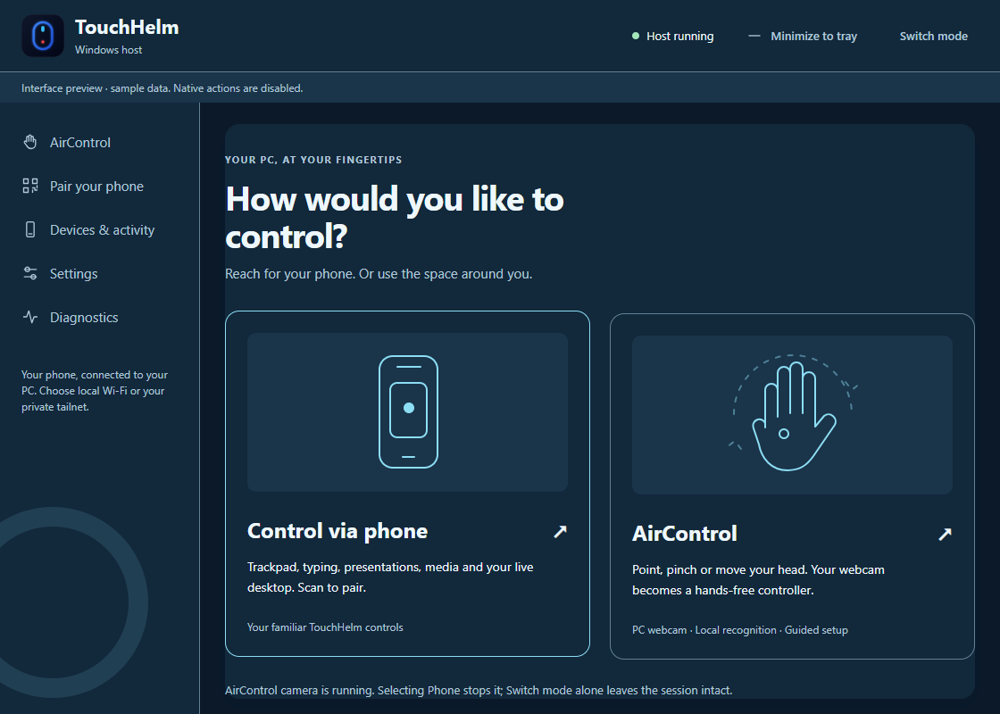

# AirControl

Control the signed-in Windows desktop with your PC webcam. Use **Hand** for an
index-finger pointer, **Head & Face** for calibrated head movement and dwell
clicking, or **Combined** for head pointing with hand actions. Face tracking
measures pose and optional expressions; it does not recognize your identity or
provide Windows sign-in.

*Interface preview, with synthetic state. No camera image or native input is used
in this picture.*

## First use

1. Launch **TouchHelm (Latest)**, then choose **AirControl**. **Switch mode** returns
   to the chooser. Paired phones stay connected.
2. Choose **Set up AirControl**. The app creates a separate Python environment,
   installs checksum-locked packages, verifies bundled model files, and loads them
   without opening a camera. Setup can take several minutes. Cancel or retry from
   the same panel; phone controls remain available if setup fails.
3. Select your PC camera and monitor. This initial runtime targets **Windows x64 /
   Python 3.13**. Allow desktop camera access in Windows Privacy settings if needed.
   Close other apps using the same webcam and select **Refresh cameras**.
4. Select **Start camera**. Nothing before this action opens the camera. Position
   your hand/face in even lighting, with room to move comfortably.
5. In Hand mode, point at the center and each of the four comfortable corner
   targets; hold still and select **Capture** for each. Head and Combined modes
   capture only the neutral head pose. Use a broad comfortable range rather than
   stretching to the edge of the camera image.
6. Practice with the simulated cursor. Test a pinch click in Hand/Combined or a
   dwell click in Head mode. Practice sends no Windows mouse/keyboard input.
7. Select **Enable PC control** while tracking is steady. This explicitly transfers
   TouchHelm input ownership to AirControl. An existing Remote stream changes to
   View; its picture and PC audio remain connected.

The Start action remains separate from enabling control. Changing a camera,
monitor, mode or saved profile requires calibration/practice again.

## Everyday controls

| Input | Result |
| --- | --- |
| Point with index finger | Move inside the calibrated movement area |
| Thumb–index pinch for 100 ms | Press left; hold and move to drag; separate to release |
| Thumb–middle pinch for 100 ms | One right click; keep the index pinch open |
| Raise index and middle, hold briefly, move vertically | Scroll; no pointing/clicking until released |
| Closed fist for 600 ms | Pause |
| Open palm for 800 ms while paused | Resume after stable tracking |
| Head movement | Point relative to the calibrated neutral pose |
| Head dwell | Left click after 900 ms within an 18-pixel target; leave the target to rearm |

Return to a neutral pointing pose between different gestures. Conflicting poses
cancel instead of producing another action. Ordinary two-eye blinking does not
click. Recenter lets you bind your hand again or set a new neutral head pose,
then leaves control paused until Resume.

**Pause/Stop:** use the panel, tray, or compact native HUD. **Ctrl+Alt+Space** is
registered while control is enabled; the panel reports if another app reserves
it. HUD/tray controls remain available in that case. The HUD does not activate a
window or steal text-field focus. In paused Head mode, a virtual cursor can dwell
only on its Resume/Recenter controls; it cannot click other PC windows.

Moving the physical mouse more than 12 pixels from AirControl's last position
pauses it. Resume is explicit. Losing required tracking, stale observations,
camera/worker failure, monitor changes or an inaccessible Windows desktop releases
AirControl's held input. The observation watchdog uses a 250 ms freshness limit.
Stop, switching to Phone, and shutdown close capture and return phone ownership.
Tracking continues when the panel is minimized; **Switch mode** alone keeps it
running, while selecting **Control via phone** stops it.

Phone drafts remain editable locally during AirControl. They are not sent when
ownership returns; use **Send** deliberately. Viewing, audio and status queries
remain available while phone input is blocked.

## Personalize and practice

- Select **Everyday**, **Presenter**, **Media** or **Custom**. Saved settings for
  each named profile are retained. Defaults reserve fist/palm as escape controls.
- In **Gesture mappings**, assign supported poses to click/drag, scrolling,
  dictation, copy/paste/undo, app switching, Windows keyboard, media or presentation
  navigation. Duplicate/conflicting assignments are rejected. This remaps known
  inputs; it does not train arbitrary new poses.
- To assign an expression, start Head/Combined practice, relax your face, then hold
  a deliberate wink, smile or eyebrow raise for at least 400 ms. Calibrate the
  observed expressions before assigning their actions. Each expression is enabled
  separately. Head mode always needs dwell or a calibrated click expression.
- Settings adjust preferred hand, sensitivity, smoothing, pinch close/release
  thresholds, hold/cooldown, dwell timing, head range, camera mirroring and landmarks.
  The two pinch thresholds provide hysteresis: release must be above close.
- The animated coach demonstrates the selected gesture and its timing. System
  reduced-motion replaces spatial animation with illustrated steps. The seven
  existing themes apply here; large ambient effects pause while tracking.

## Dictation and Voice Access

Automatic dictation defaults on. After an AirControl click/dwell selects a
supported editable field, TouchHelm checks Windows accessibility metadata twice,
excludes password/read-only fields and its own settings, and requests **Win+H**
once for that field. Drag releases and cancelled gestures do not request speech.
Disable this in Settings or map **Windows dictation** to a gesture.

If the voice-typing toolbar is open, TouchHelm leaves it open. If toolbar state is
unknown, it gives guidance rather than toggling it blindly. Select **Dictate** for
an explicit request; Windows may refuse to restore a previous destination. An
unsupported field can still be used with Windows' own Win+H shortcut. TouchHelm
reports **Dictation requested**, not an unverified listening state.

Windows voice typing requires a working microphone, internet and a supported
language. Complete its first-use permission/language prompts in Windows and wait
for Windows to show listening. See [Microsoft's voice typing guide](https://support.microsoft.com/en-us/accessibility/windows/use-voice-typing-to-talk-instead-of-type-on-your-pc).

**Voice Access** is a separate Windows 11 accessibility feature. Use its panel
button, then complete Microsoft's microphone selection and speech-model setup.
TouchHelm suppresses automatic Win+H when Voice Access is running. See
[Microsoft's Voice Access setup](https://support.microsoft.com/en-us/accessibility/windows/voice-access/set-up-voice-access).
Cancelling Windows setup does not mean speech is ready. TouchHelm neither records
the microphone nor installs a separate speech-recognition service.

## Privacy and troubleshooting

Camera inference runs in a separate local OpenCV/MediaPipe process. Only its
newest frame/observations are retained; the owned desktop bridge supplies the
preview. Phone HTTP/WebSocket commands cannot start the camera or fetch frames.
TouchHelm saves profiles/calibration, but no recordings, face templates or identity
database. Stopping clears the preview. The isolated runtime lives under the
current user's private TouchHelm storage, outside served folders.

The upstream [MediaPipe privacy notice](https://pypi.org/project/mediapipe/#privacy-notice)
says images are processed on-device while SDK usage/performance metrics are sent
to Google. TouchHelm does not claim this telemetry is disabled. Windows separately
controls speech data, permissions and online processing. Package hashes and model
provenance are recorded in `requirements-aircontrol.txt` and
`assets/aircontrol/manifest.json`; see the bundled third-party notice.

| Symptom | Action |
| --- | --- |
| No camera | Connect/reconnect it, allow Windows desktop-camera access, close competing apps, Refresh cameras |
| Lost hand cannot be reacquired | Keep the same hand visible; choose Recenter to bind it again |
| Unsteady pointer | Improve front lighting, reduce sensitivity, increase smoothing and recalibrate |
| Accidental gesture | Increase thresholds/hold/cooldown; practice before enabling; keep the unused pinch open |
| Monitor layout changed | Stop and restart calibration for the available monitor |
| Hotkey unavailable | Use native HUD, tray or desktop Pause/Stop |
| Setup failure | Check Python 3.13 x64, internet, disk space and security permissions; retry isolated setup |
| Dictation unavailable | Select a supported editable field; check Windows microphone/language setup and Voice Access state |

Microsoft Store Python is supported through resolved physical runtime paths,
including its redirected LocalAppData directory. Setup failures identify the
failing stage and underlying error rather than only suggesting network/disk
problems. The SDK metrics notice is informational and does not indicate a failed
installation.

This controls the ordinary signed-in Windows session. Elevated apps, UAC and
sign-in screens can reject input; identity authentication is outside this feature.
Hardware gesture accuracy and performance are not established by synthetic tests.
See [verification evidence and outstanding physical checks](AIRCONTROL_VERIFICATION.md).
