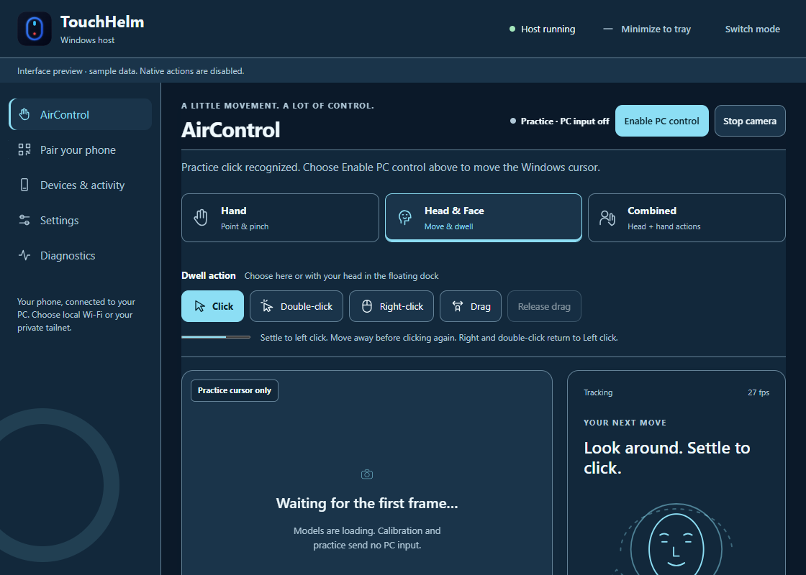
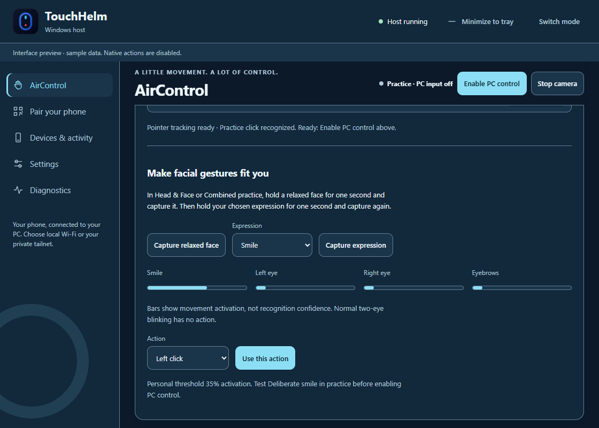

# AirControl

Control the signed-in Windows desktop with your PC webcam. **Head & Face** is the
default for new profiles, with calibrated head movement and dwell actions. Use
**Hand** for an index-finger pointer, or **Combined** for head pointing with hand
actions. Saved explicit mode choices remain intact. Face tracking
measures pose and optional expressions; it does not recognize your identity or
provide Windows sign-in.

*Interface preview, with synthetic state. No camera image or native input is used
in this picture.*

## First use

1. Launch **TouchHelm (Latest)**, then choose **AirControl**. **Switch mode** returns
   to the chooser. Paired phones stay connected.
2. Choose **Set up AirControl**. The app creates a separate Python environment,
   installs checksum-locked packages, verifies bundled model files, and loads them
   without opening a camera. Setup can take several minutes. Cancel or retry from
   the same panel; phone controls remain available if setup fails.
3. Select your PC camera and monitor. This initial runtime targets **Windows x64 /
   Python 3.13**. Allow desktop camera access in Windows Privacy settings if needed.
   Close other apps using the same webcam and select **Refresh cameras**.
4. Select **Start camera**. Nothing before this action opens the camera. Position
   your hand/face in even lighting, with room to move comfortably.
5. In Hand mode, hold your index finger comfortably near the middle and choose
   **Use this center** once. For a custom movement range, enable **Fine tune with
   five targets** and capture the center/corners instead. Head and Combined modes
   capture the neutral head pose; Combined can capture the face before the hand
   enters view. Both sources are still required for Combined PC control.
6. Practice with the simulated cursor. Test a pinch click in Hand/Combined or a
   dwell click in Head mode. The Practice tab opens after calibration. Practice
   sends no Windows mouse/keyboard input: **the Windows cursor stays still**.
7. Release the practice pinch/expression, then select **Enable PC control in the
   session header** while tracking is steady. Held gestures are not replayed on
   activation.
   The state changes from **Practice · PC input off** to **PC control on**. This explicitly transfers
   TouchHelm input ownership to AirControl. An existing Remote stream changes to
   View; its picture and PC audio remain connected.

The Start action remains separate from enabling control. Changing a camera,
monitor, mode or saved profile requires calibration/practice again.

## Everyday controls

| Input | Result |
| --- | --- |
| Point with index finger | Move inside the calibrated movement area |
| Thumb–index pinch for 100 ms | Press left; hold and move to drag; separate to release |
| Thumb–middle pinch for 100 ms | One right click; keep the index pinch open |
| Raise index and middle, hold briefly, move vertically | Scroll; no pointing/clicking until released |
| Closed fist for 600 ms | Pause |
| Open palm for 800 ms while paused | Resume after stable tracking |
| Head movement | Point relative to the calibrated neutral pose |
| Head dwell | Execute the selected action after 900 ms within a 22-pixel target; move away to rearm |

Return to a neutral pointing pose between different gestures. Conflicting poses
cancel instead of producing another action. Ordinary two-eye blinking does not
click. Recenter lets you bind your hand again or set a new neutral head pose,
then leaves control paused until Resume.

In Hand mode, face tracking is off. Choose Head & Face or Combined to track a
face. An open palm can still steer the active/practice pointer; its Resume action
applies only while paused. A thumb–index pinch does not require a straight index
finger and is recognized from landmark contact rather than a canned pose name.
Recenter during practice keeps practice running without enabling Windows input.

Pinch confirmation stabilizes the click target while the index finger curls;
keeping the pinch held still allows dragging. Pointer smoothing adapts to motion
speed instead of applying the same lag to slow pointing and fast movement. Head
smoothing accounts for monitor resolution. A 4-pixel steadiness zone suppresses
tiny movement without making the monitor edges unreachable. Settings offer
**Head steadiness** (0–12 physical pixels) and **Dwell target radius** (12–40
physical pixels). Higher steadiness reduces jitter; lower values follow small
movements more closely. Existing smoothing choices are preserved; fresh Head
profiles use 60% smoothing.

After a hand pinch releases, the pointer stays at the click or drop location.
Further hand movement continues from that position, with the movement range
mapped toward the screen edges. Recenter or a tracking interruption clears this
temporary adjustment. If you release at a movement boundary, move inward and
back to reach that edge again.

## Head-only clicks and dragging

*Synthetic interface preview. No camera is opened or input injected by the preview.*

1. Start the camera, capture your neutral head pose, and practice a dwell click.
   Select **Enable PC control** when ready; practice never controls Windows.
2. Move your head to point. Keep the pointer settled until its ring completes to
   click. Move away before clicking again; ordinary blinking has no action.
3. Choose **Click**, **Double-click**, **Right-click** or **Drag** in the panel or
   floating native dock. In active Head mode you can dwell on dock controls;
   those dwells select an action without injecting a click into another window.
   Move off the dock after choosing or resuming; keeping your head still over
   the same dock control cannot repeatedly activate it.
4. For **Drag**, settle on the source to hold the left button. Move to the
   destination, then settle again to drop. The cursor ring and panel show
   **Drag held**. **Release drag**, Pause, Stop and tracking loss also release it.
5. Right-click and double-click are one-shot selections; after use they return to
   ordinary left-click. Drag also returns to left-click after dropping. After
   **Release drag**, move away before dwelling to click again. If an expression
   was holding the drag, relax it before using it again. If dwell
   was disabled in your saved profile, explicitly choosing a dwell action enables
   it for the current session; it does not silently rewrite that saved choice.

Facial expressions are optional. In Head/Combined practice, calibrate an
expression and assign **Hold left / drag** to press while maintaining it; relax
to release. Head mode stabilizes the pre-expression target while confirming a
click, so making an expression does not immediately displace the target. Test
the movement and release in practice before enabling PC control.

The panel separately reports which sources are tracked and which gesture/action
is accepted. The hold bar shows timing, **not recognition accuracy**. Unknown or
weak classifier results are not displayed as a convincing "match percentage".
Left/right-hand classification uncertainty does not discard a tracked hand.

**Pause/Stop:** use the panel, tray, or compact native HUD. **Ctrl+Alt+Space** is
registered while control is enabled; the panel reports if another app reserves
it. HUD/tray controls remain available in that case. The HUD does not activate a
window or steal text-field focus. In paused Head mode, a virtual cursor can dwell
only on its Resume/Recenter controls; it cannot click other PC windows.

Moving the physical mouse more than 12 pixels from AirControl's last position
pauses it. Resume is explicit. Losing required tracking, stale observations,
camera/worker failure, monitor changes or an inaccessible Windows desktop releases
AirControl's held input. The observation watchdog uses a 250 ms freshness limit.
Stop, switching to Phone, and shutdown close capture and return phone ownership.
Locking Windows or opening a secure desktop also stops capture and releases
input. Unlock and choose Start camera to begin again.
Tracking continues when the panel is minimized; **Switch mode** alone keeps it
running, while selecting **Control via phone** stops it.

Phone drafts remain editable locally during AirControl. They are not sent when
ownership returns; use **Send** deliberately. Viewing, audio and status queries
remain available while phone input is blocked.

## Personalize and practice

*Interface preview with synthetic values; the bars measure activation, not
recognition confidence.*

- Select **Everyday**, **Presenter**, **Media** or **Custom**. Saved settings for
  each named profile are retained. Defaults reserve fist/palm as escape controls.
- In **Gesture mappings**, assign supported poses to click/drag, scrolling,
  dictation, copy/paste/undo, app switching, Windows keyboard, media or presentation
  navigation. Duplicate/conflicting assignments are rejected. This remaps known
  inputs; it does not train arbitrary new poses.
- To assign an expression, open **Practice** in Head/Combined mode. Hold a relaxed
  face for about one second and choose **Capture relaxed face**. Select Smile,
  Left/Right wink or Raised eyebrows, hold it for about one second and choose
  **Capture expression**. Then select an action and **Use this action**. It applies
  in practice without restarting the camera; test it before enabling PC control.
  The saved threshold comes from your measured range, with a lower release
  threshold to reduce flicker. Bars show activation, not recognition confidence.
  Enabling PC control saves the profile; **Save settings** also saves it and
  stops the camera for recalibration.
  Ordinary two-eye blinks stay inactive. Simultaneous assigned expressions cancel
  until released. Head mode still needs dwell or a calibrated click expression.
  A wink requires valid readings from both eyes; missing opposite-eye data
  cannot be treated as an open eye. Missing unrelated expression channels do not
  change the threshold used for a valid expression.
- Settings adjust preferred hand, sensitivity, smoothing, pinch close/release
  thresholds, hold/cooldown, dwell timing, head range, camera mirroring and landmarks.
  The two pinch thresholds provide hysteresis: release must be above close.
- The animated coach demonstrates the selected gesture and its timing. System
  reduced-motion replaces spatial animation with illustrated steps. The seven
  existing themes apply here; large ambient effects pause while tracking.

## Dictation and Voice Access

Automatic dictation defaults on. After an AirControl click/dwell selects a
supported editable field, TouchHelm checks Windows accessibility metadata twice,
excludes password/read-only fields and its own settings, and requests **Win+H**
once for that field. Drag releases and cancelled gestures do not request speech.
Disable this in Settings or map **Windows dictation** to a gesture.

If the voice-typing toolbar is open, TouchHelm leaves it open. If toolbar state is
unknown, it gives guidance rather than toggling it blindly. Select **Dictate** for
an explicit request; Windows may refuse to restore a previous destination. An
unsupported field can still be used with Windows' own Win+H shortcut. TouchHelm
reports **Dictation requested**, not an unverified listening state.

Windows voice typing requires a working microphone, internet and a supported
language. Complete its first-use permission/language prompts in Windows and wait
for Windows to show listening. See [Microsoft's voice typing guide](https://support.microsoft.com/en-us/accessibility/windows/use-voice-typing-to-talk-instead-of-type-on-your-pc).

**Voice Access** is a separate Windows 11 accessibility feature. Use its panel
button, then complete Microsoft's microphone selection and speech-model setup.
TouchHelm suppresses automatic Win+H when Voice Access is running. See
[Microsoft's Voice Access setup](https://support.microsoft.com/en-us/accessibility/windows/voice-access/set-up-voice-access).
Cancelling Windows setup does not mean speech is ready. TouchHelm neither records
the microphone nor installs a separate speech-recognition service.

## Privacy and troubleshooting

Camera inference runs in a separate local OpenCV/MediaPipe process. Only its
newest frame/observations are retained; the owned desktop bridge supplies the
preview. Phone HTTP/WebSocket commands cannot start the camera or fetch frames.
TouchHelm saves profiles/calibration, but no recordings, face templates or identity
database. Stopping clears the preview. The isolated runtime lives under the
current user's private TouchHelm storage, outside served folders.

The upstream [MediaPipe privacy notice](https://pypi.org/project/mediapipe/#privacy-notice)
says images are processed on-device while SDK usage/performance metrics are sent
to Google. TouchHelm does not claim this telemetry is disabled. Windows separately
controls speech data, permissions and online processing. Package hashes and model
provenance are recorded in `requirements-aircontrol.txt` and
`assets/aircontrol/manifest.json`; see the bundled third-party notice.

| Symptom | Action |
| --- | --- |
| No camera | Connect/reconnect it, allow Windows desktop-camera access, close competing apps, Refresh cameras |
| Lost hand cannot be reacquired | Keep the same hand visible; choose Recenter to bind it again |
| Unsteady pointer | Improve front lighting, reduce sensitivity, increase smoothing and recalibrate |
| Accidental gesture | Increase thresholds/hold/cooldown; practice before enabling; keep the unused pinch open |
| Monitor layout changed | Stop and restart calibration for the available monitor |
| Hotkey unavailable | Use native HUD, tray or desktop Pause/Stop |
| Setup failure | Check Python 3.13 x64, internet, disk space and security permissions; retry isolated setup |
| Dictation unavailable | Select a supported editable field; check Windows microphone/language setup and Voice Access state |

Microsoft Store Python is supported through resolved physical runtime paths,
including its redirected LocalAppData directory. Setup failures identify the
failing stage and underlying error rather than only suggesting network/disk
problems. The SDK metrics notice is informational and does not indicate a failed
installation.

This controls the ordinary signed-in Windows session. Elevated apps, UAC and
sign-in screens can reject input; identity authentication is outside this feature.
Hardware gesture accuracy and performance are not established by synthetic tests.
See [verification evidence and outstanding physical checks](AIRCONTROL_VERIFICATION.md).
