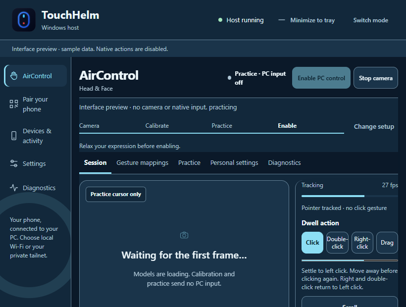
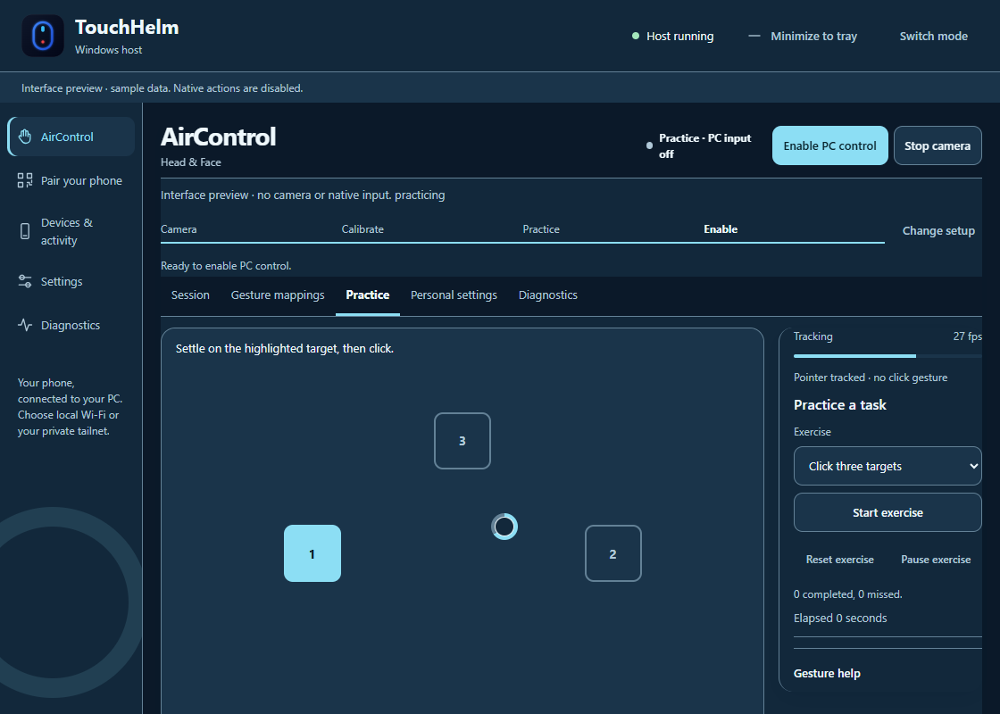

# AirControl daily-use workspace — 18 October 2026

This release develops the existing control engine and desktop workspace for
comfortable everyday use and clearer setup for new users. It does not replace
the MediaPipe runtime or claim a measured improvement in physical recognition
accuracy. All screenshots here contain explicit synthetic preview state.

## Delivered behavior

- The movement area appears in the initial minimum-size desktop view, with a
  persistent session header and escape controls. Readiness guidance comes from
  the same local service checks used by Enable; repeated Enable cannot reacquire
  input. Camera start and PC control remain separate actions.
- Session, Practice, Personal settings and Diagnostics separate everyday tasks.
  Change setup stops control before presenting device/mode choices. Optional
  expression setup and gesture help no longer dominate the movement area.
- Click, drag and scroll exercises evaluate real simulated action proposals.
  Correct targets, misses, timing, pause, resize revisions and interruptions are
  handled by the service/pure evaluator. Starting an exercise returns ownership;
  practice never injects native input. Free practice still satisfies activation.
- Head scroll uses Up/Down/Done and a virtual cursor while holding the Windows
  cursor still. Direction departure stops repeat immediately. Native click,
  drag, pointing and automatic dictation are excluded during scrolling. Tracking
  loss, stale active frames, monitor changes, physical takeover and all escape
  transitions cancel it.
- Diagnostics retain up to 600 latency samples and 100 exercise results. Median
  and nearest-rank p95 describe the bounded window. Stopped duration freezes;
  unavailable data remains unknown. Export is explicit, local and field-allowlisted;
  the owned host supplies the running build label.
- Earlier hand release continuity, complete wink evidence, explicit-drop dwell
  consumption and calibrated expression rearming repairs remain covered.





## Automated evidence

| Check | Observed result |
| --- | --- |
| Full Python suite | 403 passed; native input mocked |
| Full browser behavior | 80/80 passed, including phone/Remote/pairing and desktop |
| JavaScript units | 86 passed, one existing optional DOM test skipped |
| AirControl browser/visual/accessibility batch | 16/16 passed |
| Layout coverage | Seven themes, light/dark, 820×620 / 1120×800 / 1440×900; 410 CSS px effective reflow and keyboard escape controls |
| Axe audit | 22 scans across session states and theme appearances; zero reported violations |
| Status announcements | Identical snapshots produce zero repeated message mutations |
| Motion replay | 36 synthetic scenarios compared with baseline `40f2c93`; comparison passed |
| Native HUD smoke check | Non-activation, owned Pause callback and virtual pointer passed; two cameras enumerated, none opened |
| Whitespace | `git diff --check` passed |

The layout batch checks bounds and minimum targets; screenshots of the minimum
workspace, practice, calibration and sampled theme states were inspected. The
410 CSS px viewport represents the reflow width of an 820 px workspace at 200%
zoom; this is not a claim that all Windows DPI/device combinations were tested.
The final independent code-review outcome is recorded in the execution ledger
and final delivery message.

## Synthetic motion comparison

The same default Head profile and deterministic observations were fed to the
baseline and current pure engines. These times exclude camera, inference,
display and human reaction. No baseline response regression was observed:

| Coordinate scale | Updates/sec | Current 90% step response | Baseline |
| --- | ---: | ---: | ---: |
| 1920×1080 | 10 | 200 ms | 200 ms |
| 1920×1080 | 15 | 133.3 ms | 133.3 ms |
| 1920×1080 | 30 | 100 ms | 100 ms |
| 3840×2160 | 10 | 200 ms | 200 ms |
| 3840×2160 | 15 | 133.3 ms | 133.3 ms |
| 3840×2160 | 30 | 133.3 ms | 133.3 ms |

Stationary replay had zero pointer RMS jitter. With alternating ±0.65-degree yaw
input, RMS jitter at 10/15/30 updates/sec was 6.47/3.96/0.64 pixels at HD and
11.91/7.93/2.85 pixels at 4K. Those are fixture outcomes, not detector accuracy.
Conflict fixtures produced no unintended actions, drag loss released on the
first invalid observation, and coordinate edges remained reachable.

Reproduce from the project root:

```powershell
.\.venv\Scripts\python.exe -m unittest discover -s tests -p 'test_*.py'
npm test
node tests/test_web_client.cjs --behavior-only
node tests/test_web_client.cjs --visual '--filter=AirControl'
.\.venv\Scripts\python.exe tests/aircontrol_replay.py --output .tmp/aircontrol-daily-use-replay.json --baseline-ref 40f2c93
```

The replay extracts baseline Python sources into a separate temporary directory;
it does not move this checkout's Git state. Axe tooling is pinned and used only
by development tests; see [development notices](THIRD_PARTY_DEVELOPMENT.md).

## Participating-user acceptance still required

No webcam was opened during this implementation. The new workspace and synthetic
tests do not establish comfort, fatigue, gesture accuracy, low-light robustness,
or camera-to-screen latency for this person. Existing roughly 10 fps room
observations remain a camera delivery limitation; no higher capture rate is
claimed here.

Use this checklist when the person is ready to test:

- [ ] Start with the camera off; complete explicit Start, calibration, practice
  and Enable without hidden assistance or unexpected PC input.
- [ ] Complete click, drag and scroll tasks using the intended Head/Hand/Combined
  modes. Record misses, elapsed time, interruptions and comfort feedback.
- [ ] Verify ordinary blinks remain inactive and deliberate calibrated
  expressions activate and release predictably.
- [ ] Exercise Pause/Resume, Stop, Recenter, occlusion/reacquisition and physical
  mouse takeover, including during a held drag and scrolling.
- [ ] Test available camera unplug/reconnect, low light and minimized operation.
- [ ] Use the system for 30 minutes; export a sanitized report and record actual
  resource/delivery measurements and comfort. Stop if the person wants to stop.
- [ ] Record untested monitor/DPI/rotation or speech scenarios as unverified.

Source commits remain local. Restart TouchHelm to load the updated desktop and
Python service before a participating-user trial.
