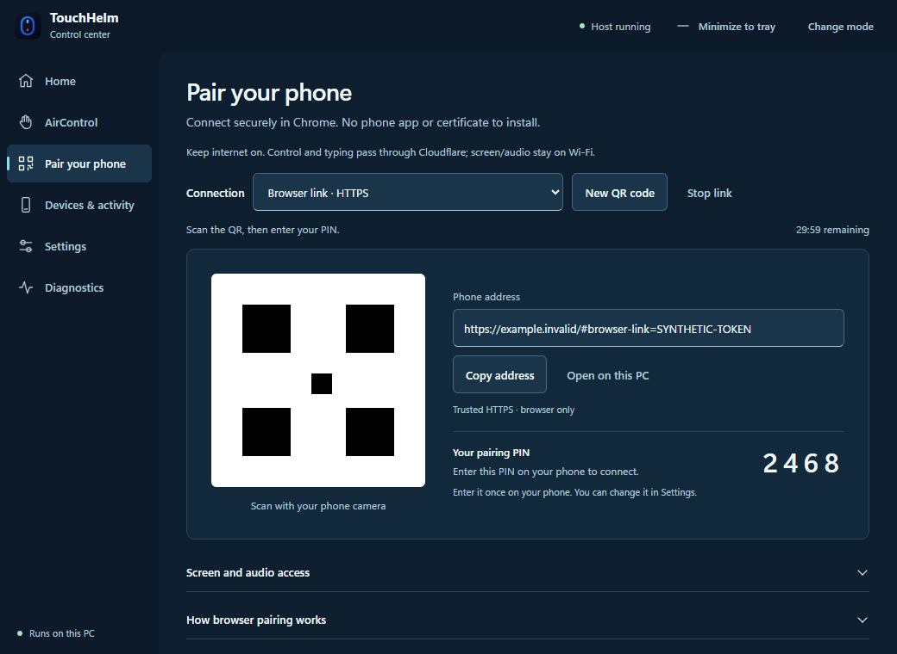

# Test 5 verification — 26 October 2026

Browser link is an optional test transport. See [setup and limits](BROWSER_LINK.md).
No live PC was exposed during the public network test: the origin served only a
synthetic phone page/API/PIN socket, with no native input or screen capture.

Checks completed:

- Full Python suite: 528 tests passed. Final case-insensitive gateway route
  hardening: all 6 gateway tests passed again.
- JavaScript unit suite: 122 passed, 1 existing skip.
- Existing browser interaction suite: 88/88 passed.
- Desktop pairing browser suite: 8 passed; the optional image-capture check ran
  separately and passed. Viewports included 820×620, 1040×760 and 410×620.
- Pinned official cloudflared 2026.10.3: release SHA-256 matched; Windows reported
  a valid Authenticode signature. The unmodified binary and license are bundled.
- Real public HTTPS/WSS: normal TLS validation, one-use QR exchange, Secure /
  HttpOnly / SameSite=Strict cookie, PIN challenge, authenticated socket, replay
  rejection and blocked private/CA/preview routes passed.
- Actual headless Chrome: fragment removed, secure context, PIN connection,
  cookie refresh, no service worker and no script errors passed.
- Staged installed launcher: 20 dependency/UI/model checks passed with no system
  Python in PATH and deliberately invalid PYTHONHOME/PYTHONPATH. Exit code 0.
- Stop/revocation releases held input and preserves ordinary LAN sockets.
  Startup cancellation and withholding QR until public HTTPS verification passed.

Temporary hostname DNS failures occurred on some separate test runs. Quick
Tunnels have no uptime guarantee. The desktop verifies the public route before
showing a QR and leaves a retry action on failure. Physical Android Chrome,
banking-app behavior and screen/audio through this signaling mode remain for
the user's test. Existing local WebRTC transport/capture code is unchanged.

UI evidence below uses a synthetic address, PIN and illustrative QR fixture;
it is not a working pairing code or a screenshot of private PC data.

The normal Windows desktop copy was upgraded in place to 2.2.0.5. Its Installed
apps/uninstall registration, uninstaller, desktop and Start shortcuts, unchanged
settings, new server sources and responsive window passed. All 20 installed
runtime checks passed with system Python unavailable, exit code 0. The running
host's installed source identity, local API, required PIN and authenticated
WebSocket passed without PC input. No public browser link was started on the
live PC during this verification.

Installer: `TouchHelm-2.2.0-test5-setup-win-x64.exe`, 181,696,078 bytes
(173.3 MiB). SHA-256:
`cdef05f125520739d470a229fff8f60ed097e165d4a9a53cb1fda7523f33b323`.
The installer is unsigned; its SmartScreen behavior is unchanged.

